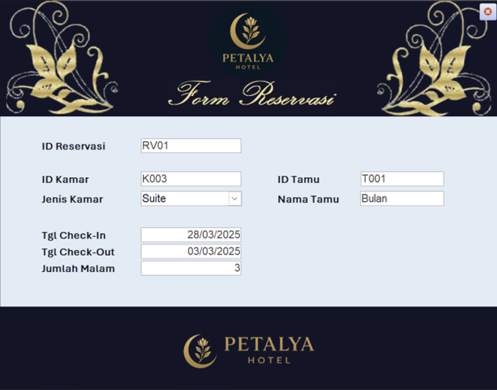
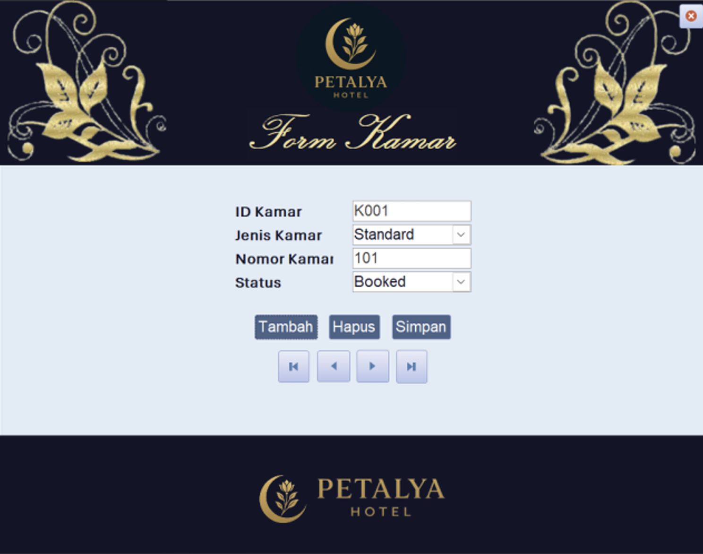
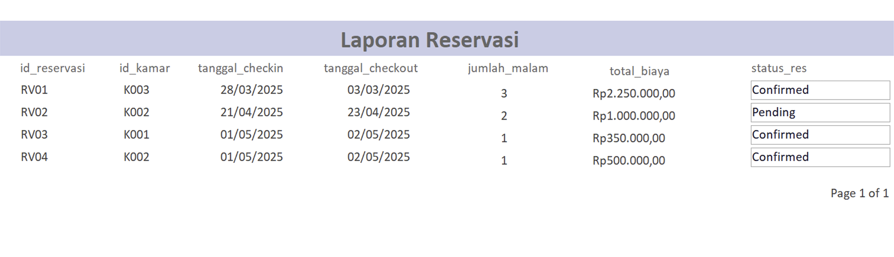

# petalya-hotel-reservation-db
Relational Database Management System for Hotel Reservation &amp; Billing built with Microsoft Access (Petalya Hotel).

# 🏨 Sistem Informasi Reservasi Hotel — Petalya Hotel

Perancangan dan implementasi sistem basis data relasional berbasis **Microsoft Access** untuk mendigitalisasi pengelolaan data tamu, ketersediaan unit kamar, transaksi reservasi, hingga pelaporan pembayaran pada **Petalya Hotel**.

---

## 📌 Latar Belakang & Tujuan
Pengelolaan operasional perhotelan secara manual maupun terpisah rentan menimbulkan ketidaksinkronan data—seperti tumpang tindih jadwal pemesanan (*double booking*), kesalahan kalkulasi total biaya menginap, serta lambatnya proses rekapitulasi pembayaran. 

Proyek ini bertujuan membangun sistem basis data relasional yang terintegrasi untuk memastikan:
- Konsistensi dan integritas data antar entitas operasional hotel.
- Kemudahan pencatatan transaksi melalui antarmuka *Form* dan *Subform* yang saling terhubung.
- Otomatisasi pembuatan laporan operasional siap cetak.

---

## 🗄️ Arsitektur Basis Data (5 Tabel Relasional)
Sistem ini dirancang menggunakan pendekatan pemodelan relasional dengan penerapan *Primary Key* (PK) dan *Foreign Key* (FK) pada 5 tabel utama:

| Nama Tabel | Primary Key | Foreign Key | Deskripsi |
| :--- | :--- | :--- | :--- |
| **`Tamu`** | `id_tamu` | - | Menyimpan data profil dan kontak tamu hotel. |
| **`Kategori_Kamar`** | `id_jenis_kamar` | - | Master data tipe kamar (*Standard, Deluxe, Suite*), fasilitas, dan tarif per malam. |
| **`Kamar`** | `id_kamar` | `id_jenis_kamar` | Mencatat nomor unit kamar beserta status ketersediaan (*Available* / *Booked*). |
| **`Reservasi`** | `id_reservasi` | `id_tamu`, `id_kamar` | Mencatat transaksi pemesanan, tanggal *check-in/check-out*, durasi malam, dan total biaya. |
| **`Pembayaran`** | `id_pembayaran` | `id_reservasi` | Mencatat detail transaksi pelunasan, tanggal bayar, nominal, dan metode pembayaran. |

### Diagram Relasi Antartabel

---

## 🖥️ Fitur Antarmuka & Pelaporan

### 1. Forms & Subforms Terintegrasi
- **Form Tamu:** Antarmuka input dan pencarian profil tamu.
- **Form Kamar + Subform:** Menampilkan detail unit kamar sekaligus histori pemesanan pada kamar terkait.
- **Form Reservasi + Subform:** Antarmuka utama pencatatan reservasi yang terhubung langsung dengan rincian transaksi pembayaran tamu.

### 2. Laporan Operasional (Reports)
Sistem menyediakan 3 format laporan terstruktur yang siap dicetak maupun diekspor ke PDF:
- **Laporan Tamu Hotel:** Rekap daftar tamu terdaftar.
- **Laporan Reservasi:** Ringkasan jadwal *check-in/check-out* dan total biaya inap.
- **Laporan Pembayaran:** Rekapitulasi status dan metode pembayaran transaksi.

---

## 📂 Struktur Repositori
- `database/` — File aplikasi basis data Microsoft Access (`.accdb`).
- `docs/` — Dokumentasi lengkap perancangan dan laporan akhir proyek (`.pdf`).
- `assets/` — Tangkapan layar antarmuka sistem, relasi tabel, dan output laporan.

---

## 🚀 Cara Menjalankan Proyek
1. Pastikan perangkat telah terinstal **Microsoft Access** (versi 2016 atau lebih baru).
2. Unduh file `Petalya_Hotel.accdb` dari folder [`/database`]
3. Buka file tersebut dan klik **Enable Content** pada bilah peringatan keamanan di bagian atas agar seluruh *Form*, *Subform*, dan *Report* dapat berjalan normal.

---

## 🎓 Informasi Proyek
- **Konteks:** Tugas Akhir (UAS) Mata Kuliah Konsep Basis Data — Program Studi S1 Sistem Informasi, Institut Teknologi PLN (Tahun Akademik 2024/2025).
- **Tim Penyusun:** Petique Bulan Nanindah, Alya Luna Ramadhani, Auliya Rizky Aminah.
